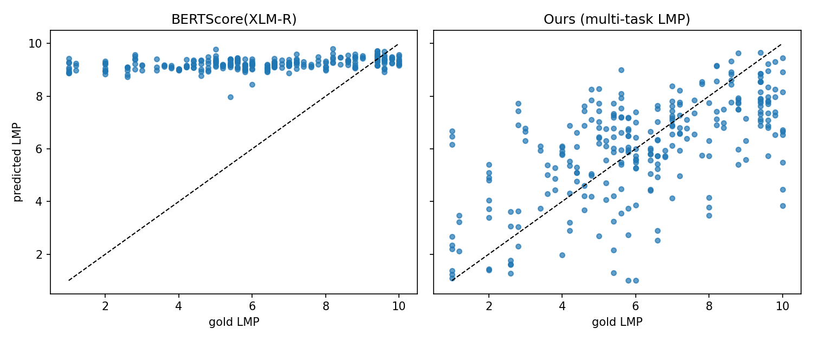
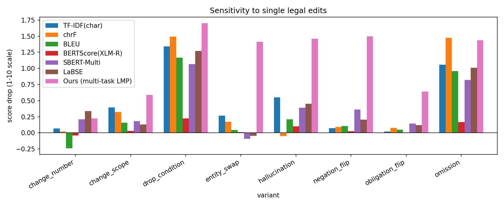

# Results - Explainable Multilingual Legal Meaning Preservation

Model `xlm-roberta-base`, 3 seeds [42, 43, 44], 270 test pairs (90 each in French, English, Hindi). Data: FrJUDGE (297 French pairs, 5 law-student annotators) + NLLB-200 English/Hindi translations. English and Hindi gold scores are the French human labels projected through translation.

All numbers are generated from the CSV files in [`results/`](results/) by `scripts/make_results_summary.py`.

## Final results

| Measure | Our model | Best baseline |
| --- | --- | --- |
| Pearson with human scores (3 seeds) | **0.58 ± 0.02** (0.61 with the 3 seed models averaged) | 0.41 (BERTScore) |
| French alone | **0.70** (the paper's French-only model: 0.74) | 0.53 (BERTScore) |
| English / Hindi | **0.58 / 0.56** | 0.41 / 0.37 |
| Unrelated legal sentences scored correctly low | **94%** | 37% (BLEU) |
| Average score drop after one legal edit | **1.12** | 0.47 (TF-IDF char) |

## 1. Generic similarity metrics vs. our model (Experiment 1)

| System | Pearson | 95% CI | Spearman | RMSE | MAE | % over-estimated | Decision macro-F1 |
| --- | --- | --- | --- | --- | --- | --- | --- |
| **Ours (multi-task LMP)** | **0.576 ± 0.018** | [0.53, 0.69] (averaged) | 0.553 ± 0.018 | 2.118 ± 0.086 | 1.644 ± 0.082 | 38.148 ± 3.954 | 0.530 ± 0.026 |
| BERTScore | 0.413 | [0.32, 0.52] | 0.428 | 3.834 | 3.125 | 80.741 | 0.209 |
| chrF | 0.41 | [0.31, 0.51] | 0.401 | 2.507 | 2.064 | 22.963 | 0.3 |
| BLEU | 0.316 | [0.20, 0.43] | 0.305 | 4.291 | 3.788 | 5.556 | 0.233 |
| TF-IDF char | 0.281 | [0.18, 0.39] | 0.307 | 2.391 | 1.907 | 35.556 | 0.406 |
| LaBSE | 0.178 | [0.07, 0.30] | 0.214 | 3.45 | 2.767 | 75.185 | 0.219 |
| SBERT-Multi | 0.081 | [-0.03, 0.19] | 0.103 | 3.572 | 2.87 | 74.815 | 0.219 |

Ours = mean ± std over the seeds. "% over-estimated" = predictions more than 0.5 points above the human score.

BERTScore gives almost every simplification 9-10; our model follows the human scores.

## 2. Languages and zero-shot transfer (Experiment 2)

| Test language | Setting | Ours: Pearson | Best baseline: Pearson |
| --- | --- | --- | --- |
| French | joint training (fr + en + hi) | **0.698** | 0.527 (BERTScore) |
| English | joint training (fr + en + hi) | **0.584** | 0.412 (chrF) |
| Hindi | joint training (fr + en + hi) | **0.556** | 0.373 (chrF) |
| Hindi | zero-shot, trained on English only | **0.373** | - |
| English | zero-shot, trained on French only | **0.459** | - |
| Hindi | zero-shot, trained on French only | **0.396** | - |
| English | zero-shot, trained on Hindi only | **0.425** | - |

The paper's French-only JUDGEBERT reaches 0.74 on French.

## 3. New legal domain (Experiment 3)

| Setting | System | Pearson | % over-estimated | Pairs |
| --- | --- | --- | --- | --- |
| in-domain (joint training) | Ours | 0.611 | 35.9 | 270 |
| in-domain | BERTScore | 0.413 | 80.7 | 270 |
| out-of-domain insurance->tenancy (silver probe) | Ours | 0.309 | 68.3 | 202 |

The tenancy probe uses rule-labelled pairs.

## 4. Sanity checks (Experiment 4)

| System | Identical pairs scored ~10 | Unrelated legal pairs scored ~1 | Mean score, unrelated (expect 1) |
| --- | --- | --- | --- |
| **Ours + augmentation** | 95.2% | 93.7% | 1.04 |
| **Ours, no augmentation** | 0.0% | 0.0% | 4.26 |
| BLEU | 100.0% | 36.7% | 1.15 |
| SBERT-Multi | 100.0% | 1.5% | 4.34 |
| TF-IDF char | 100.0% | 0.4% | 2.44 |
| chrF | 100.0% | 0.0% | 2.76 |
| BERTScore | 100.0% | 0.0% | 8.60 |
| LaBSE | 100.0% | 0.0% | 5.11 |

## 5. Sensitivity to a single legal edit (Experiment 5a)

| Legal edit | Ours: score drop | Best baseline: drop |
| --- | --- | --- |
| Condition dropped | **1.70** | 1.49 (chrF) |
| Negation flipped | **1.50** | 0.36 (SBERT-Multi) |
| Fact added (hallucination) | **1.46** | 0.55 (TF-IDF char) |
| Omission | **1.44** | 1.48 (chrF) |
| Parties swapped | **1.41** | 0.27 (TF-IDF char) |
| Obligation flipped (shall -> may) | **0.64** | 0.14 (SBERT-Multi) |
| Scope changed | **0.59** | 0.40 (TF-IDF char) |
| Number or date changed | **0.23** | 0.34 (LaBSE) |

Higher = the metric reacts more to the legal change.

## 6. Improvement attempt: legal-edit augmentation (Experiment 5d, negative result)

| System (seed 42) | Pearson | RMSE | % over-estimated | Avg. edit drop | Number edit drop | Negation drop |
| --- | --- | --- | --- | --- | --- | --- |
| Ours (main) | 0.597 | 2.05 | 43.7 | 1.64 | 1.08 | 1.91 |
| Ours + legal-edit augmentation | 0.496 | 2.40 | 23.7 | 0.88 | -0.31 | 2.77 |

Training on rule-made edits of real pairs lowered agreement with humans, so the final model does not use it.

## 7. Case study

20 explained cases with the law students' own justifications: [`results/exp5c_qualitative_cases.md`](results/exp5c_qualitative_cases.md).

## Reproduce

Open `JUDGEBERT_LMP_Colab.ipynb` in Colab (T4 GPU) and run all cells; it regenerates every file in `results/`. Then run `python scripts/make_results_summary.py`.
